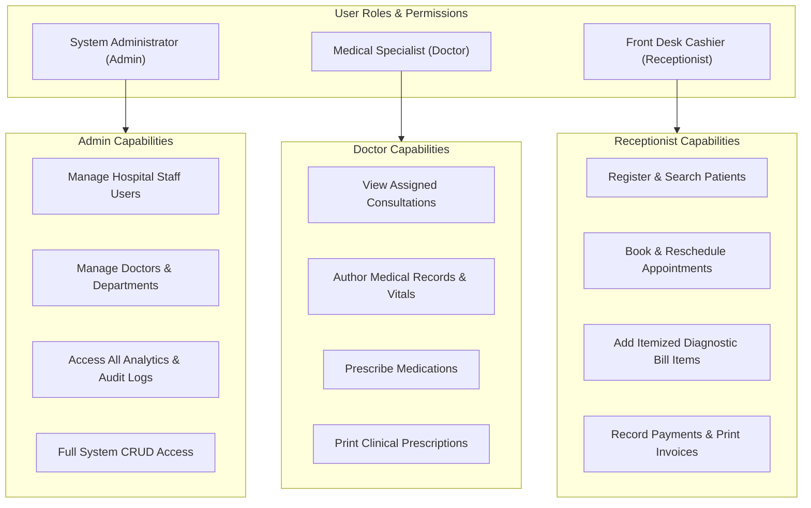

# Chapter 1: Project Overview & Technology Stack

## 1. Project Introduction

The **Hospital Management System** (configured in this project as **Apex General Hospital**) is a full-stack, enterprise-grade clinical management application developed for an undergraduate **Computer Science & Engineering Database Management Systems (DBMS)** academic curriculum.

In contemporary medical environments, outpatient clinical centers handle hundreds of daily consultations, high volumes of diagnostic orders, itemized billing computations, and ongoing prescription updates. Traditional paper-based registers and unlinked spreadsheets introduce severe human errors, duplicate data entries, scheduling collisions, and financial reconciliation discrepancies.

This project bridges software engineering and relational database theory by integrating a high-performance **PostgreSQL** relational database with a modular **Node.js/Express.js** RESTful backend and a responsive **React.js 19 (Vite)** single-page frontend. Every system feature is backed by strict relational schema constraints, stored logic, transactional atomicity, and role-based access control.

---

## 2. Problem Statement & Real-World Motivation

### The Challenges of Legacy and Manual Systems
1. **Data Redundancy & Inconsistency**: Patient demographics (such as names, contact details, and dates of birth) are repeatedly written across registration books, doctor prescription pads, and cashier invoice sheets. When a patient changes their contact number or address, only one record gets updated, leading to inconsistent, conflicting states across departments.
2. **Double-Booking Collisions (Race Conditions)**: Multiple reception desks simultaneously booking appointments without concurrency control often assign two different patients to the exact same doctor at the exact same timeslot.
3. **Manual Calculation Errors in Invoicing**: Adding itemized diagnostics (e.g., ECG, blood tests, radiology scans) manually often results in mathematical errors, untracked balances, or unintentional overpayments that are legally problematic.
4. **Lack of Auditing & Clinical Governance**: In paper logs, when an appointment is cancelled or a clinical diagnosis is modified, there is no immutable audit trail indicating *who* made the modification, *when* it happened, and *what* the previous values were.
5. **No Real-Time Operational Insight**: Hospital administrators cannot quickly ascertain daily revenue collections, doctor appointment workloads, or department performance without tedious manual tallying.

### The Proposed Solution
Our Hospital Management System eliminates these vulnerabilities through:
- A strictly normalized relational schema adhering to **Third Normal Form (3NF)**.
- **Pessimistic row-level database locking (`SELECT ... FOR UPDATE`)** and **composite unique constraints** preventing timeslot conflicts.
- **Automated database triggers and stored procedures** that automatically calculate line item charges, compute balances, and update payment statuses.
- **Automated database-level audit logging** preserving historical records of critical changes.
- **Role-Based Access Control (RBAC)** ensuring administrative staff, doctors, and cashiers only access authorized functions.

---

## 3. Project Objectives

The project was designed with clear academic and practical objectives:

1. **Relational Schema Rigor**: Design a normalized database schema in PostgreSQL that enforces primary keys, foreign keys, uniqueness, default values, and domain check constraints without redundancy.
2. **ACID Transaction Enforcement**: Implement atomic, consistent, isolated, and durable (ACID) multi-step operations (e.g., booking an appointment concurrently creates an initial consultation invoice; recording a payment atomically updates invoice balances and creates an audit entry).
3. **Concurrency Safety**: Implement database-level guarantees against race conditions and double bookings using pessimistic locking.
4. **Automated Business Logic inside DBMS**: Move critical financial calculations and audit tracking into database triggers and stored procedures (`PL/pgSQL`), reducing reliance on external application logic.
5. **Modern RESTful API**: Develop an Express.js backend that securely communicates with PostgreSQL using connection pooling, parameterized queries (SQL injection prevention), and JWT authentication.
6. **Intuitive Medical User Interface**: Deliver a clean, responsive React frontend with accessible medical status indicators, timeslot availability pickers, and print-ready document templates (invoices and prescriptions).
7. **Comprehensive Operational Analytics**: Provide analytical SQL views with instant tabular views and CSV data exports for hospital decision-makers.

---

## 4. Key Features & Role-Based Access Control (RBAC)

The application implements three distinct user roles, reflecting standard hospital hierarchy and operational responsibilities:



### Detailed Functional Modules

#### 1. Executive Dashboard (`/dashboard`)
- Real-time aggregated key performance indicators (KPIs) powered by the database view `v_dashboard_stats`:
  - Total Active Patients
  - Active Specialist Doctors
  - Clinical Departments
  - Today's Scheduled Appointments
  - Completed Appointments Count
  - Total Revenue Collected (₹)
  - Total Outstanding Patient Balance (₹)
- Live list of today's upcoming appointments with patient and doctor details.
- Department workload distribution badges.

#### 2. Patient Directory & Management (`/patients`, `/patient-detail`)
- Complete patient registration capturing full name, date of birth, biological gender, blood group, contact number, email, address, and emergency contact details.
- Automated sequential patient code generation (e.g., `PAT-1001`, `PAT-1002`).
- Dynamic real-time calculation of patient age from date of birth.
- Instant search by patient name, patient code, and mobile phone number.
- Patient profile page displaying patient demographic history, past appointments, medical consultations, and billing ledger.

#### 3. Doctor & Department Administration (`/doctors`, `/departments`)
- Department registry covering department name, description, physical ward location (e.g., Block A, 3rd Floor), and designated Head of Department (HOD).
- Doctor registry linking specialists to their assigned departments and user login accounts.
- Doctor consultation fee schedules, working days (`Mon,Tue,Wed,Thu,Fri`), and clinical shift hours (`09:00:00` to `17:00:00`).

#### 4. Appointment Booking & Timeslot Conflict Guard (`/appointments`, `/book-appointment`)
- Interactive appointment scheduling screen with doctor and department selection.
- Timeslot availability picker that visually indicates occupied vs. free slots.
- **Double-Booking Prevention**: Database-level `CONSTRAINT uq_doctor_slot UNIQUE` and transactional row locking ensuring two receptionists cannot book the same doctor at the same slot.
- **Automatic Invoice Generation**: Booking an appointment immediately initializes an associated consultation fee invoice in the `bills` table within the same atomic transaction.
- Status management: `Scheduled`, `Completed`, `Cancelled`, `No-Show`, with cancellation reasons logged to the audit table.

#### 5. Clinical Documentation & Medical Records (`/medical-records`)
- Restricted to doctors and administrators: Documenting clinical diagnosis, presenting symptoms, treatment plans, clinical notes, and scheduled follow-up dates.
- Structured **JSONB** vital signs logging: Blood Pressure (`"120/80"`), Pulse (`72`), Temperature (`"98.6 F"`), and Body Weight (`65 kg`).
- Consultation completion automatically marks the corresponding appointment status as `Completed`.

#### 6. Pharmacy & E-Prescriptions (`/prescriptions`)
- Multi-item prescription writer attached to consultation records.
- Captures medicine name, dosage (e.g., `500 mg`), frequency (e.g., `Twice daily after meals`), treatment duration (e.g., `5 days`), and clinical instructions.
- Print-ready hospital prescription slip with hospital header, doctor details, patient vitals, diagnosis, and tabular medication schedule.

#### 7. Diagnostic Invoicing & Billing (`/billing`)
- Unified invoice tracking linked to consultations.
- Dynamic itemized charges: Add laboratory tests (e.g., 12-Lead ECG, Lipid Profile, Digital X-Ray) to existing invoices.
- **Database Trigger Recalculation**: Insertion, modification, or deletion of bill line items immediately executes `fn_sync_bill_totals`, synchronizing `additional_charges`, `total_amount`, and `balance_amount`.
- Invoice status auto-tagging: `Unpaid`, `Partially Paid`, `Paid`.

#### 8. Payments Ledger & Overpayment Guardrail (`/payments`)
- Multi-mode payment recording: Cash, Card, UPI, and NetBanking Online.
- Unique receipt reference generation (`PAY-YYYYMMDD-XXXX`).
- **Overpayment Protection**: Database procedure rejects payment attempts exceeding the invoice's remaining balance.
- Print-ready official hospital tax invoice receipt showing consultation fees, diagnostic charges, discounts, taxes, amount paid, and remaining balance.

#### 9. DBMS Analytical Reports & CSV Export (`/reports`)
- Dedicated SQL analytics suite executing complex views and aggregations:
  - Doctor Appointment Workloads (`v_doctor_appointments`)
  - Patient Billing & Outstanding Ledger (`v_patient_billing_summary`)
  - Daily Revenue Collections by Payment Mode (`v_daily_revenue_report`)
  - Date-filtered Patient Registration Reports
- One-click **Export to CSV** triggering binary streaming downloads directly from the database query result.

#### 10. Staff User Administration (`/users`, `/profile`)
- Admin-controlled staff user provisioning with role assignment (`Admin`, `Doctor`, `Receptionist`).
- Profile management with current password verification before password modification.
- Soft-deactivation toggle preventing deactivated staff from logging in.

---

## 5. Technology Stack Overview

The project is built entirely on modern, standard open-source tools:

```text
+---------------------------------------------------------------------------------------+
|                                    FRONTEND TIER                                      |
|  - React.js 19.3.1 (Modern functional components, Hooks, Context API)                |
|  - Vite 8.3.4 (Next-generation lightning-fast build tool & dev server)               |
|  - Lucide React 1.60.0 (Standardized medical & interface vector iconography)          |
|  - Pure Vanilla CSS Design System (High contrast, CSS Variables, Print Media Styles)  |
+---------------------------------------------------------------------------------------+
                                           | HTTP REST / JSON
                                           v
+---------------------------------------------------------------------------------------+
|                                    BACKEND TIER                                       |
|  - Node.js v24.12.0 (High-performance asynchronous JavaScript runtime)               |
|  - Express.js 4.21.2 (Minimalist, robust REST API routing framework)                  |
|  - pg (node-postgres) 8.13.3 (PostgreSQL client pool with parameterized queries)      |
|  - bcryptjs 3.0.3 (Blowfish cipher password hashing with 10 salt rounds)              |
|  - jsonwebtoken 9.0.2 (HMAC SHA-256 signed stateless JWT authentication)              |
|  - morgan 1.10.1 (HTTP request logger for dev diagnostics)                            |
|  - cors 2.8.5 (Cross-Origin Resource Sharing security configuration)                  |
|  - dotenv 17.2.4 (Environment variable management)                                   |
+---------------------------------------------------------------------------------------+
                                           | PostgreSQL Protocol (Port 2007 / 5432)
                                           v
+---------------------------------------------------------------------------------------+
|                                   DATABASE TIER                                       |
|  - PostgreSQL 14+ / 18.4 (Object-relational ACID database management system)          |
|  - PL/pgSQL (Procedural language for stored procedures and trigger functions)         |
|  - B-Tree Performance Indexes (Optimized search and foreign key join trees)           |
|  - Native JSONB Engine (Structured document storage for patient vital signs)          |
+---------------------------------------------------------------------------------------+
```

### Detailed Breakdown of Technologies

| Layer | Component | Version | Role in Project | Why Chosen? |
| :--- | :--- | :--- | :--- | :--- |
| **Database** | PostgreSQL | 14+ / 18.4 | Primary relational data store | Full ACID compliance, robust support for check constraints, stored procedures (`PL/pgSQL`), advanced triggers, and native JSONB handling. |
| **Database Driver**| `pg` (node-postgres) | 8.13.3 | Database connection pooling & query executor | Supports parameterized queries (`$1, $2`) for 100% SQL injection prevention, pooled client acquisition (`pool.connect()`), and transaction management (`BEGIN/COMMIT/ROLLBACK`). |
| **Backend Runtime**| Node.js | v24.12.0 | Asynchronous server engine | Non-blocking event-driven architecture, native support for JSON payloads, high I/O concurrency. |
| **Backend Framework**| Express.js | 4.21.2 | REST API pipeline | Clean middleware chain architecture (`authMiddleware`, `roleMiddleware`, centralized `errorHandler`), clear modular routing. |
| **Security: Passwords**| `bcryptjs` | 3.0.3 | Password hashing & salt generation | Implements the adaptive Blowfish-based key derivation function. Protects against rainbow tables and brute-force attacks via 10 salt rounds. |
| **Security: Auth** | `jsonwebtoken` | 9.0.2 | Stateless session management | Cryptographically signs token with secret key and 24-hour expiry; allows horizontal scalability without server-side session stores. |
| **Frontend Framework**| React.js | 19.3.1 | Single-Page Application (SPA) | Component-based architecture, declarative state management (`useState`, `useEffect`), and Context API for global session state. |
| **Frontend Build** | Vite | 8.3.4 | Development server & bundler | Instant Hot Module Replacement (HMR), lightning-fast ES module bundling. |
| **Iconography** | `lucide-react` | 1.60.0 | User interface iconography | Clean, accessible vector icons for medical, financial, and administrative indicators. |
| **Styling** | Vanilla CSS | CSS3 | Custom medical design system | Zero external UI library bloat; clean custom styling using CSS custom properties (variables), accessible colors, flexbox/grid, and `@media print` rules for physical slips. |

