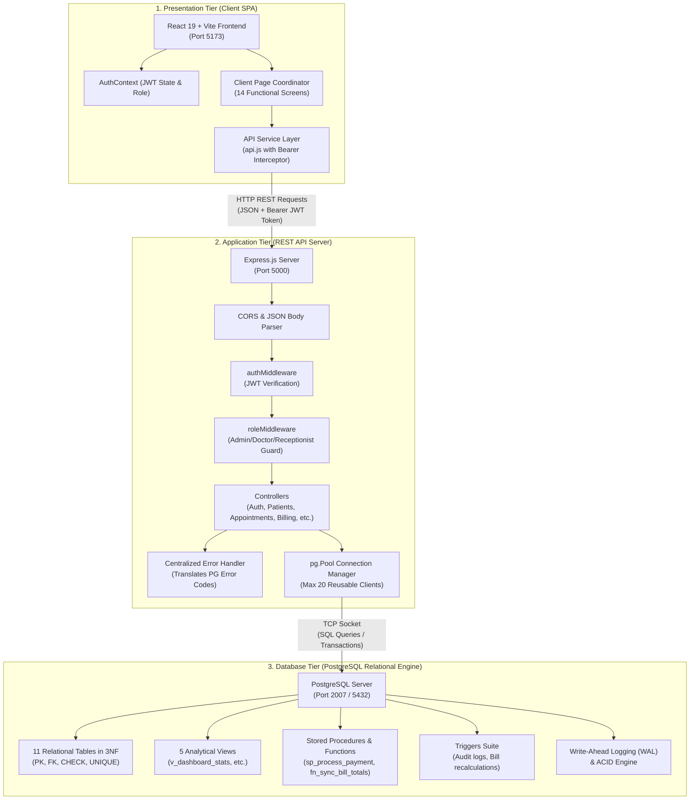
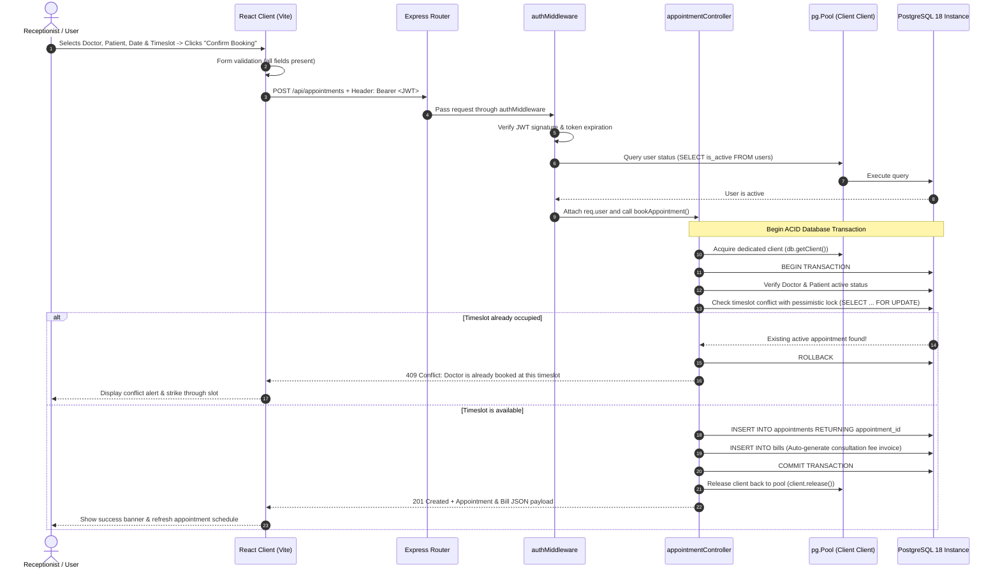
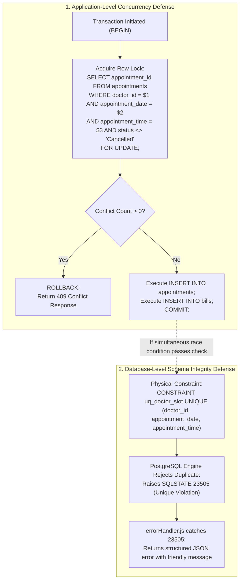

# Chapter 2: System Architecture & Data Flow

## 1. High-Level Three-Tier Architecture

The **Hospital Management System** is architected as a classical **Three-Tier Client-Server System**, strictly segregating the presentation interface, application business logic, and relational persistent storage.

This separation of concerns ensures modularity, high maintainability, independent scalability, and security isolation.

---

## 2. Tier-by-Tier In-Depth Breakdown

### Tier 1: Presentation Tier (React.js Frontend)
- **Role**: Handles user interaction, client-side state, form validations, role-based screen rendering, and printable reports.
- **Key Modules**:
  - `client/src/App.jsx`: Main navigation coordinator rendering page components dynamically based on the active tab and user credentials.
  - `client/src/context/AuthContext.jsx`: Provides global authentication state (`user`, `token`, `login`, `logout`) via React's Context API.
  - `client/src/services/api.js`: Centralized HTTP fetch client that automatically attaches the stored Bearer token (`localStorage.getItem('hospital_token')`) to outgoing requests and handles automatic logout on `401 Unauthorized` responses.
  - `client/src/pages/`: 14 dedicated views for dashboards, patient profiles, appointment scheduling, electronic medical records, invoices, payments, and SQL analytics.
  - `client/src/components/common/`: Reusable, accessible UI components including `Modal`, `ConfirmDialog`, `Pagination`, `StatusBadge`, `StatCard`, `LoadingSkeleton`, `Header`, and `Sidebar`.

### Tier 2: Application Tier (Node.js & Express.js Backend)
- **Role**: Serves as the gateway between the frontend interface and the database. It enforces business rules, verifies JSON Web Tokens, validates input payloads, coordinates ACID transactions, and transforms raw relational tuples into structured JSON responses.
- **Key Modules**:
  - `server/src/server.js`: Server bootstrap script loading environment variables, initiating connection tests, and listening on `PORT 5000`.
  - `server/src/app.js`: Express pipeline mounting CORS, JSON parsers, Morgan logging, health checks, and 11 distinct REST API route modules.
  - `server/src/middleware/authMiddleware.js`: Intercepts protected requests, parses the `Authorization: Bearer <token>` header, verifies the cryptographic signature with `jsonwebtoken`, and checks whether the user account is still active in PostgreSQL.
  - `server/src/middleware/roleMiddleware.js`: High-order authorization middleware ensuring only permitted roles (e.g., `Admin`, `Doctor`, or `Receptionist`) can execute specific controller actions.
  - `server/src/middleware/errorHandler.js`: Centralized error interceptor mapping low-level PostgreSQL SQLSTATE error codes (`23505`, `23503`, `23514`, `P0001`) into user-friendly HTTP JSON status messages.
  - `server/src/config/db.js`: Initializes a connection pool via `pg.Pool` (maximum 20 idle clients), with automatic fallback logic across multiple `.env` locations and connection verification helpers.

### Tier 3: Database Tier (PostgreSQL Relational Engine)
- **Role**: The authoritative system of record. Responsible for persistent storage, enforcing relational integrity constraints (Primary Keys, Foreign Keys, Unique Keys, Check Constraints), managing concurrency locks, executing stored procedures, firing triggers, and generating analytical views.
- **Key Modules**:
  - `database/schema.sql`: 11 relational tables normalized to 3NF, audit log structure, and 16 B-Tree performance indexes.
  - `database/views.sql`: 5 pre-compiled multi-table analytical views reducing client-side join overhead.
  - `database/functions.sql`: Stored functions and procedures (`fn_sync_bill_totals`, `sp_process_payment`, `sp_book_appointment`) executing transactional calculations inside the database engine.
  - `database/triggers.sql`: Triggers automating `updated_at` timestamps, capturing appointment state transitions into `audit_logs`, recalculating invoice balances on line item changes, and logging payments.
  - `database/reports.sql`: Comprehensive library of academic SQL queries demonstrating DDL, DML, Joins, Aggregations, Grouping, and Correlated Subqueries.

---

## 3. End-to-End Request-Response Lifecycle Flow

To understand how data flows through the application, consider the end-to-end lifecycle of a client booking an appointment:

---

## 4. Concurrency & Transaction Boundary Architecture

In a multi-user hospital environment, race conditions pose a severe risk. Two receptionists at different counters might simultaneously attempt to book the last available 10:00 AM slot for the same doctor.

Our architecture prevents this at two independent layers:

### Why Both Layers Are Essential
1. **The Row-Locking Check (`FOR UPDATE`)**: Allows the server to gracefully detect the conflict, abort cleanly without throwing unhandled exceptions, and provide detailed diagnostic feedback to the client.
2. **The Schema Unique Constraint (`uq_doctor_slot`)**: Acts as the ultimate, unyielding physical defense. Even if an application bug or direct external SQL query bypasses the application check, PostgreSQL's relational engine physically guarantees that two records sharing the same doctor, date, and time cannot coexist.

---

## 5. Security & Isolation Architecture

The system implements security across every layer of the architectural stack:

```mermaid
graph LR
    subgraph ClientSec["Client Security"]
        LS["localStorage Token Storage"]
        Interceptor["Fetch Interceptor with Bearer Token"]
        AutoLogout["Auto 401 Logout Clear"]
    end

    subgraph TransportSec["Transport Security"]
        CORSConfig["Strict CORS Origin Whitelist\n(http://localhost:5173)"]
        JSONParser["Strict Body Size Parsing"]
    end

    subgraph ServerSec["Server Security"]
        BcryptHash["bcrypt Blowfish Hashing\n(10 Salt Rounds)"]
        JWTSign["HMAC SHA-256 JWT Signing\n(24h Expiry)"]
        RoleGuard["authorizeRoles('Admin', ...)"]
    end

    subgraph DatabaseSec["Database Security"]
        ParamQueries["Parameterized Queries ($1, $2)\nZero SQL Injection Risk"]
        NoPlainPassword["No Plaintext Passwords in DB"]
        AuditLogs["Immutable audit_logs Table"]
    end

    ClientSec --> TransportSec
    TransportSec --> ServerSec
    ServerSec --> DatabaseSec
```

### Security Highlights
- **No Plaintext Passwords**: Passwords are never stored in the database. When a user registers or changes their password, `bcrypt.hash(password, 10)` generates a 60-character salted hash. During authentication, `bcrypt.compare()` verifies the candidate password against the stored hash in constant time, preventing timing attacks.
- **Stateless Tokens**: The backend does not maintain memory-heavy session tables. The client receives a signed JWT upon authentication. If the backend is restarted, users remain authenticated until their token expires.
- **SQL Injection Prevention**: SQL string concatenation (e.g. `'SELECT * FROM users WHERE username = ' + user_input`) is strictly forbidden across all controllers. Every query uses parameterized placeholders (`$1, $2, $3`). The PostgreSQL client sends parameters separately from the SQL statement; PostgreSQL parses the SQL syntax first, eliminating any possibility of parameter content being interpreted as executable SQL syntax.
- **Database Error Code Translation**: Raw database error stacks (which might leak table names or server directory structures) are intercepted by `errorHandler.js` and converted into clean JSON error codes before reaching the client.

