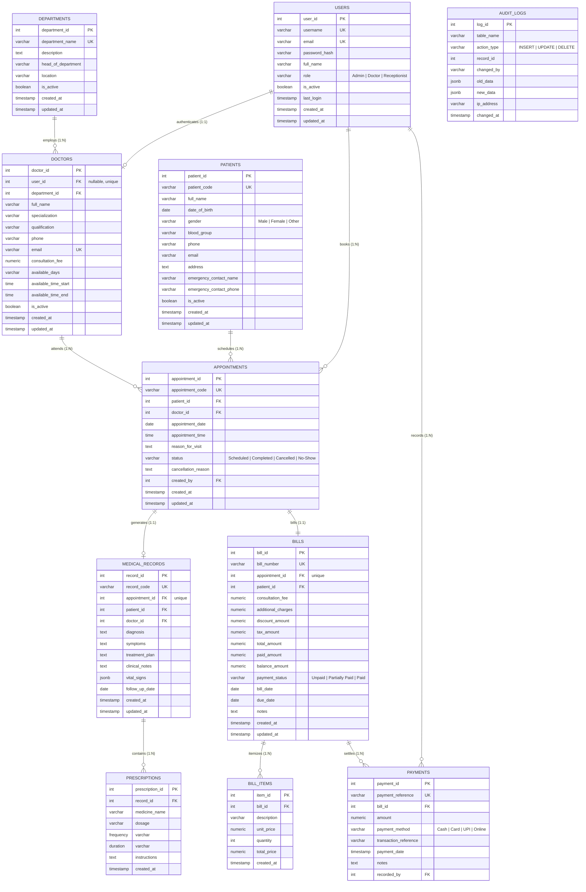

# Chapter 4: Entity-Relationship Diagram & Database Normalization

## 1. Entity-Relationship (ER) Conceptual Model

The conceptual and logical foundation of the **Hospital Management System** is built on relational modeling principles. In relational database design, real-world hospital entities (such as patients, doctors, medical records, and invoices) are mapped to formal relations with defined cardinalities, participation constraints, and integrity boundaries.

---

## 2. Mermaid Entity-Relationship Diagram (ERD)

The following Mermaid diagram illustrates the 11 entities, their primary/foreign keys, and their structural relationships:

---

## 3. Entity Cardinality & Participation Rules

| Entity Pair | Relationship Name | Cardinality | Participation | Rationale & Structural Rule |
| :--- | :---: | :---: | :---: | :--- |
| **`departments` &rarr; `doctors`** | Employs | 1 : N | Mandatory on Doctor, Optional on Dept | A doctor must belong to exactly one department (`department_id NOT NULL`). A department can have zero or multiple doctors. |
| **`users` &rarr; `doctors`** | Authenticates | 1 : 1 | Optional on both sides | A user account with role `Doctor` maps to at most one doctor record (`user_id UNIQUE`). Doctors without logins can exist. |
| **`patients` &rarr; `appointments`**| Books | 1 : N | Mandatory on Appt, Optional on Patient | An appointment must reference one patient (`patient_id NOT NULL`). A patient may have zero, one, or many appointments. |
| **`doctors` &rarr; `appointments`** | Attends | 1 : N | Mandatory on Appt, Optional on Doctor | An appointment must have one doctor (`doctor_id NOT NULL`). A doctor may attend many appointments over time. |
| **`appointments` &rarr; `medical_records`**| Generates | 1 : 1 | Mandatory on Record, Optional on Appt | An appointment generates at most one medical record (`appointment_id UNIQUE`). A newly booked appointment has none. |
| **`appointments` &rarr; `bills`** | Invoices | 1 : 1 | Mandatory on Bill, Mandatory on Appt | Every appointment generates exactly one invoice (`appointment_id UNIQUE`). |
| **`medical_records` &rarr; `prescriptions`**| Prescribes | 1 : N | Mandatory on Rx, Optional on Record | A medical record can have zero to many prescribed medicines (`record_id NOT NULL, ON DELETE CASCADE`). |
| **`bills` &rarr; `bill_items`** | Itemizes | 1 : N | Mandatory on Item, Optional on Bill | An invoice can contain multiple itemized diagnostic tests (`bill_id NOT NULL, ON DELETE CASCADE`). |
| **`bills` &rarr; `payments`** | Settles | 1 : N | Mandatory on Payment, Optional on Bill | A bill may receive multiple partial payment installments (`bill_id NOT NULL, ON DELETE RESTRICT`). |
| **`users` &rarr; `appointments`** | Schedules | 1 : N | Optional on Appt, Optional on User | Tracks the receptionist who created the appointment booking (`created_by ON DELETE SET NULL`). |
| **`users` &rarr; `payments`** | Collects | 1 : N | Optional on Payment, Optional on User | Tracks the cashier who recorded the payment transaction (`recorded_by ON DELETE SET NULL`). |

---

## 4. Understanding Normalization: Theory & Anomalies

### What is Database Normalization?
Normalization is the systematic mathematical process of organizing relations and functional dependencies in a database schema to:
1. Minimize data redundancy (avoiding duplicate storage of facts).
2. Prevent update anomalies.
3. Enforce referential integrity and simplify schema maintenance.

### The Three Classic Anomalies of Unnormalized Databases
To understand why normalization is mandatory in a Hospital Management System, consider what happens if a hospital maintains all records in a single flat spreadsheet or unnormalized table:

$$\text{FlatHospitalTable}(\text{patient\_code}, \text{patient\_name}, \text{doctor\_name}, \text{dept\_name}, \text{dept\_location}, \text{appointment\_date}, \text{medicines\_prescribed}, \dots)$$

1. **Insertion Anomaly**:
   - *Problem*: You cannot add a newly created hospital department (e.g., *Radiology* in Block D) until you have hired a doctor and booked a patient into that department.
   - *Solution in our 3NF schema*: `departments` is an independent relation. A department can be created immediately without doctors or appointments.
2. **Deletion Anomaly**:
   - *Problem*: If the only patient visiting *Dermatology* cancels and their record is deleted, all information regarding the Dermatology department (its HOD and physical location) is permanently erased from the system!
   - *Solution in our 3NF schema*: Deleting an appointment record in `appointments` leaves `doctors` and `departments` completely intact due to `ON DELETE RESTRICT`.
3. **Update (Modification) Anomaly**:
   - *Problem*: If the Cardiology department moves from *Block A, 3rd Floor* to *Block C, 4th Floor*, a database administrator would have to update thousands of historical patient rows. If a single row is missed, the database enters an inconsistent state where Cardiology is reported in two different locations simultaneously.
   - *Solution in our 3NF schema*: The location is stored in exactly one row in the `departments` table. Updating that single row instantly updates the location for all doctors, appointments, and queries across the entire hospital.

---

## 5. Step-by-Step Normalization Proofs (1NF &rarr; 2NF &rarr; 3NF)

Let us formally trace how our schema progresses from **Unnormalized Form (UNF)** to **Third Normal Form (3NF)**.

---

### Step 1: First Normal Form (1NF)

#### Formal Definition
A relation $R$ is in **First Normal Form (1NF)** if and only if:
1. Every attribute value is **atomic** (indivisible and non-composite).
2. The relation contains **no repeating groups** or multi-valued attributes (no comma-separated arrays stored in a single cell).
3. Every tuple is uniquely identifiable by a distinct **Primary Key**.

#### Violation in Unnormalized Form (UNF)
Consider how medication prescriptions and diagnostic charges might be stored by a naive designer:

$$\text{ConsultationRecord}(\text{record\_id}, \text{patient\_name}, \text{medicines\_prescribed}, \text{diagnostic\_tests})$$

| `record_id` | `patient_name` | `medicines_prescribed` (Multi-valued!) | `diagnostic_tests` (Multi-valued!) |
| :---: | :--- | :--- | :--- |
| `1` | Aarav Patel | `"Atenolol 50mg, Aspirin 75mg, Atorvastatin 20mg"` | `"ECG (₹450), Lipid Profile (₹750)"` |

**Why this breaks 1NF**:
- The attribute `medicines_prescribed` contains multiple values.
- You cannot index, sort, or query for patients taking *"Aspirin"* without slow string scans (`LIKE '%Aspirin%'`).
- You cannot calculate the total diagnostic fee using mathematical SQL functions (`SUM()`).

#### 1NF Decomposition in Our Schema
We eliminate repeating groups by decomposing the multi-valued attributes into dedicated child tables where each row represents exactly one atomic item:

1. **Atomic Prescriptions Entity**:
   $$\text{prescriptions}(\underline{\text{prescription\_id}}, \text{record\_id}, \text{medicine\_name}, \text{dosage}, \text{frequency}, \text{duration}, \text{instructions})$$
   - Each row contains exactly one medicine with atomic dosage, frequency, and duration.
2. **Atomic Bill Items Entity**:
   $$\text{bill\_items}(\underline{\text{item\_id}}, \text{bill\_id}, \text{description}, \text{unit\_price}, \text{quantity}, \text{total\_price})$$
   - Each diagnostic charge is represented as an atomic row with numeric fields allowing `SUM(total_price)`.

> **Conclusion**: Because all column attributes contain single, atomic values and every table possesses an explicit primary key, the schema satisfies **1NF**.

---

### Step 2: Second Normal Form (2NF)

#### Formal Definition
A relation $R$ is in **Second Normal Form (2NF)** if and only if:
1. The relation is already in **1NF**.
2. There are **no partial functional dependencies** on any candidate key; that is, every non-prime attribute is **fully functionally dependent** on the primary key.
   *(Note: Partial dependency can only exist if a relation has a composite candidate key composed of two or more attributes).*

#### Potential Violation Analysis in Our Schema
In our `appointments` table, there is a natural composite candidate key guaranteeing that a doctor cannot be double-booked:

$$\text{Candidate Key} = \{\text{doctor\_id}, \text{appointment\_date}, \text{appointment\_time}\}$$

Suppose an unnormalized design stored doctor demographic and department details inside the `appointments` table:

$$\text{Appointments}(\underline{\text{doctor\_id}, \text{appointment\_date}, \text{appointment\_time}}, \text{patient\_id}, \text{doctor\_name}, \text{doctor\_specialization}, \text{consultation\_fee}, \text{status})$$

Let us analyze the Functional Dependencies (FDs):
- $\text{FD}_1: \{\text{doctor\_id}, \text{appointment\_date}, \text{appointment\_time}\} \rightarrow \text{patient\_id}, \text{status}$ *(Full dependency on the whole key)*
- $\text{FD}_2: \text{doctor\_id} \rightarrow \text{doctor\_name}, \text{doctor\_specialization}, \text{consultation\_fee}$ *(Partial dependency on a subset of the candidate key!)*

**Why this breaks 2NF**:
`doctor_name` depends solely on `doctor_id`. It has nothing to do with `appointment_date` or `appointment_time`. If Dr. Sarah Jenkins has 50 appointments, her name and fee would be duplicated 50 times.

#### 2NF Decomposition in Our Schema
We isolate all attributes functionally dependent solely on `doctor_id` into their own relation:

$$\text{doctors}(\underline{\text{doctor\_id}}, \text{full\_name}, \text{specialization}, \text{qualification}, \text{consultation\_fee}, \dots)$$
$$\text{appointments}(\underline{\text{appointment\_id}}, \text{patient\_id}, \text{doctor\_id}, \text{appointment\_date}, \text{appointment\_time}, \text{status}, \dots)$$

- In `appointments`, the surrogate key `appointment_id` serves as a single-column primary key.
- By mathematical definition, any relation whose candidate keys consist of a **single attribute** is automatically immune to partial dependencies and therefore satisfies **2NF**.

> **Conclusion**: Since all tables in our schema employ single-attribute primary keys (`SERIAL PRIMARY KEY`), no non-prime attribute depends on a partial key. Therefore, the schema satisfies **2NF**.

---

### Step 3: Third Normal Form (3NF)

#### Formal Definition
A relation $R$ is in **Third Normal Form (3NF)** if and only if:
1. The relation is already in **2NF**.
2. There are **no transitive dependencies** for non-prime attributes; that is, no non-key attribute is functionally dependent on another non-key attribute.
   *(Formally, for every non-trivial functional dependency $X \rightarrow Y$, either $X$ is a superkey or $Y$ is a prime attribute).*

*Informal Rule*: Every non-key attribute must depend on **the key, the whole key, and nothing but the key**.

#### Transitive Dependency Violation Analysis
Let us examine the relationship between doctors and departments. Suppose department details were kept directly in the `doctors` table:

$$\text{doctors}(\underline{\text{doctor\_id}}, \text{full\_name}, \text{specialization}, \text{department\_id}, \text{department\_name}, \text{head\_of\_department}, \text{location})$$

Let us analyze the Functional Dependencies (FDs):
- $\text{FD}_1: \text{doctor\_id} \rightarrow \text{department\_id}$ *(Primary Key determines department)*
- $\text{FD}_2: \text{department\_id} \rightarrow \text{department\_name}, \text{head\_of\_department}, \text{location}$ *(Department ID determines department metadata)*

Notice that:
$$\text{doctor\_id} \rightarrow \text{department\_id} \rightarrow \text{location}$$
Therefore:
$$\text{doctor\_id} \rightarrow \text{location} \quad \text{(Transitive Dependency!)}$$

**Why this breaks 3NF**:
`location` is a non-prime attribute determined by `department_id`, which is also a non-prime attribute in `doctors`. This causes severe anomalies:
- If Cardiology has 10 doctors, the string `"Block A, 3rd Floor"` is duplicated 10 times.
- If all Cardiology doctors retire, the department itself is erased (Deletion Anomaly).

#### 3NF Decomposition in Our Schema
We resolve this transitive dependency by extracting the intermediate determinant into its own relation:

1. **Independent Department Entity**:
   $$\text{departments}(\underline{\text{department\_id}}, \text{department\_name}, \text{head\_of\_department}, \text{location}, \text{description})$$
   Here: $\text{department\_id}$ is a superkey. Every attribute depends strictly on $\text{department\_id}$.
2. **Normalized Doctor Entity**:
   $$\text{doctors}(\underline{\text{doctor\_id}}, \text{department\_id}, \text{full\_name}, \text{specialization}, \text{consultation\_fee}, \dots)$$
   Here: $\text{department\_id}$ is maintained merely as a foreign key reference. All doctor attributes depend strictly on $\text{doctor\_id}$.

#### Another 3NF Example: Billing and Itemization
- An unnormalized bill storing patient addresses or line-item descriptions would have:
  $$\text{bill\_id} \rightarrow \text{patient\_id} \rightarrow \text{patient\_address}$$
  $$\text{bill\_id} \rightarrow \text{item\_id} \rightarrow \text{item\_description}$$
- In our schema:
  - Patient address is stored strictly in `patients(patient_id)`.
  - Item descriptions and unit prices are stored strictly in `bill_items(item_id)`.
  - Master bill calculations (`total_amount`, `paid_amount`, `balance_amount`) are guaranteed by check constraints and trigger functions rather than stored denormalized strings.

> **Conclusion**: There are no transitive dependencies in any table. Every non-key attribute depends directly on the primary key. Therefore, the schema strictly adheres to **Third Normal Form (3NF)**.

---

## 6. Normal Form Verification Matrix

The following matrix verifies that all 11 tables in the Hospital Management System satisfy 1NF, 2NF, and 3NF:

| Table Name | Primary Key | 1NF Compliance | 2NF Compliance | 3NF Compliance | Justification |
| :--- | :--- | :---: | :---: | :---: | :--- |
| `departments` | `department_id` | Yes | Yes | Yes | All columns atomic; single PK; department metadata depends solely on `department_id`. |
| `users` | `user_id` | Yes | Yes | Yes | Single credential per row; role and password hash depend solely on `user_id`. |
| `doctors` | `doctor_id` | Yes | Yes | Yes | Single PK; department attributes extracted to `departments` eliminating transitive dependency. |
| `patients` | `patient_id` | Yes | Yes | Yes | Atomic demographic columns; emergency contact attributes depend solely on `patient_id`. |
| `appointments` | `appointment_id`| Yes | Yes | Yes | Single PK; doctor and patient details referenced via foreign keys. |
| `medical_records`| `record_id` | Yes | Yes | Yes | Single PK; prescriptions decomposed into separate child table; JSONB vitals are structured. |
| `prescriptions` | `prescription_id`| Yes | Yes | Yes | Atomic line items per medication; dosage and frequency depend solely on `prescription_id`. |
| `bills` | `bill_id` | Yes | Yes | Yes | Single PK; itemized diagnostic tests extracted to `bill_items`; patient info referenced via FK. |
| `bill_items` | `item_id` | Yes | Yes | Yes | Atomic line item charges; unit price and quantity depend solely on `item_id`. |
| `payments` | `payment_id` | Yes | Yes | Yes | Atomic financial receipts; amount and payment method depend solely on `payment_id`. |
| `audit_logs` | `log_id` | Yes | Yes | Yes | Immutable event logs; action and JSON snapshots depend solely on `log_id`. |

