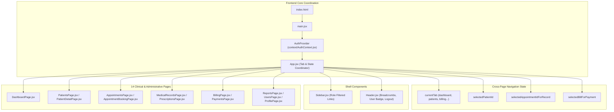
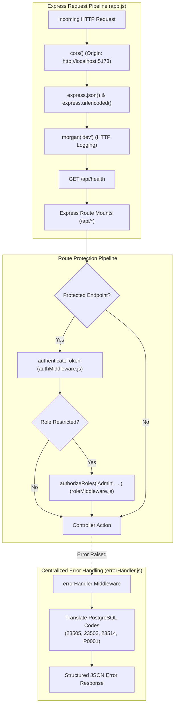
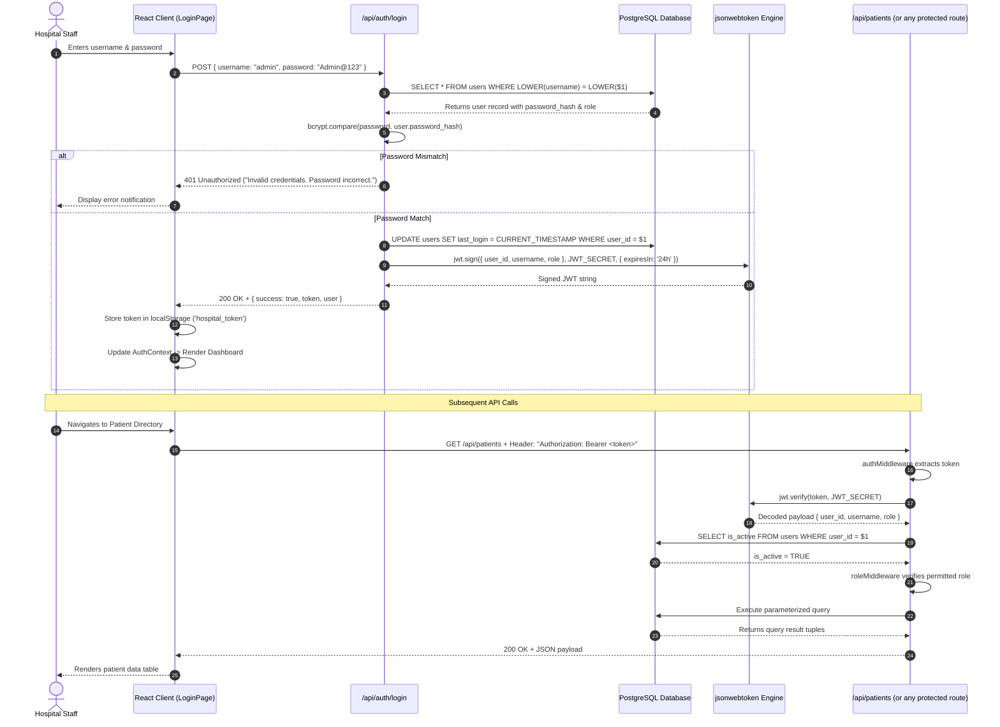

# Chapter 6: Frontend, Backend, API & Authentication Workflow

## 1. Frontend Architecture (React 19 + Vite)

The frontend is a modern, responsive Single-Page Application (SPA) built using **React 19.3.1** and bundled with **Vite 8.3.4**. It provides a role-aware clinical interface for hospital staff with zero bulky third-party UI framework dependencies.



### Key Frontend Architecture Features
1. **Context-Driven Global Authentication (`AuthContext.jsx`)**:
   - Manages `token`, `user`, `loading`, and `isAuthenticated`.
   - Persists session tokens in `localStorage` under keys `hospital_token` and `hospital_user`.
   - On initial mount, reads stored token and queries `GET /api/auth/me` to verify that the session has not expired or been revoked on the server.
2. **Centralized HTTP Client (`services/api.js`)**:
   - Intercepts all outgoing fetch requests.
   - Automatically injects `Authorization: Bearer <token>` when a token exists.
   - Intercepts `401 Unauthorized` responses: automatically flushes `localStorage` and redirects the user to `/login`.
   - Supports binary streaming for CSV reports (`response.blob()`).
3. **Reusable Design System Components (`components/common/`)**:
   - `Modal.jsx`: Accessible modal dialog for adding bill items, prescriptions, and editing forms.
   - `ConfirmDialog.jsx`: Two-step destructive action confirmation (e.g., cancelling appointments or deactivating accounts).
   - `Pagination.jsx`: Universal page-based navigation with previous/next controls and record counts.
   - `StatusBadge.jsx`: Color-coded semantic badges for appointment states (`Scheduled`, `Completed`, `Cancelled`) and billing statuses (`Paid`, `Partially Paid`, `Unpaid`).
   - `StatCard.jsx`: Reusable KPI card with trend indicator and vector iconography.
   - `LoadingSkeleton.jsx`: Clean skeleton screens displayed while fetching data.
4. **Print Media CSS System**:
   - Custom `@media print` rules in `index.css` strip navigation bars, sidebars, and action buttons, formatting prescriptions and invoices for physical A4 printing with hospital letterheads.

---

## 2. Backend Architecture (Express.js & Node.js)

The backend is built with **Node.js (v24)** and **Express.js (4.21)**. It follows the **Model-View-Controller (MVC)** design pattern, where:
- **Models**: PostgreSQL relational tables, views, and PL/pgSQL stored procedures.
- **Controllers**: Asynchronous functions handling request validation, database query dispatching, and response formatting.
- **Views**: Standardized JSON REST responses.



### PostgreSQL Connection Pool Architecture (`config/db.js`)
Instead of opening a new TCP socket connection for every incoming HTTP request (which incurs heavy latency and consumes operating system socket descriptors), the backend maintains a **Connection Pool** using `pg.Pool`:
- **Pool Size**: Configured with `max: 20` reusable client connections.
- **Idle Timeout**: Connections idle for 30 seconds are recycled (`idleTimeoutMillis: 30000`).
- **Connection Timeout**: Fast abort after 4 seconds if PostgreSQL is unreachable (`connectionTimeoutMillis: 4000`).
- **Dedicated Transaction Clients**: For ACID transactions (`BEGIN ... COMMIT`), `db.getClient()` checks out a dedicated client from the pool and returns it via `client.release()` inside a `finally` block.

### PostgreSQL Error Code Translation (`errorHandler.js`)
The centralized error handler inspects PostgreSQL SQLSTATE error codes and returns friendly HTTP responses:
- **`23505` (Unique Violation)**: Returns `409 Conflict` with the detailed duplicate key constraint message (e.g., patient code or doctor slot collision).
- **`23503` (Foreign Key Violation)**: Returns `400 Bad Request` explaining that the referenced entity does not exist or cannot be deleted.
- **`23514` (Check Constraint Violation)**: Returns `400 Bad Request` indicating that input values broke a database domain constraint.
- **`P0001` (PL/pgSQL User Exception)**: Returns `400 Bad Request` displaying custom error strings raised by `RAISE EXCEPTION` in stored procedures (e.g., overpayment errors).

---

## 3. Authentication & Authorization Workflow

The application implements a stateless **JSON Web Token (JWT)** authentication model combined with salted **bcrypt** password hashing:



---

## 4. Complete REST API Catalog

The backend exposes 35 endpoints organized into 11 functional route groups:

### 1. Authentication & Staff Management (`/api/auth`)

| Method | Endpoint | Access Level | Description |
| :--- | :--- | :--- | :--- |
| `POST` | `/api/auth/login` | Public | Authenticates credentials and returns signed JWT token. |
| `GET` | `/api/auth/me` | Authenticated | Retrieves profile of currently authenticated user. |
| `PUT` | `/api/auth/profile` | Authenticated | Updates legal name and email address. |
| `PUT` | `/api/auth/change-password` | Authenticated | Changes password (requires old password verification). |
| `GET` | `/api/auth/users` | Admin Only | Lists all registered staff accounts. |
| `POST` | `/api/auth/users` | Admin Only | Provisions a new staff account (Admin, Doctor, Receptionist). |
| `PATCH`| `/api/auth/users/:id/toggle`| Admin Only | Toggles user active/inactive status. |

### 2. Executive Dashboard (`/api/dashboard`)

| Method | Endpoint | Access Level | Description |
| :--- | :--- | :--- | :--- |
| `GET` | `/api/dashboard/stats` | Authenticated | Real-time KPI counts from `v_dashboard_stats`, recent appointments, department stats. |

### 3. Patient Management (`/api/patients`)

| Method | Endpoint | Access Level | Description |
| :--- | :--- | :--- | :--- |
| `GET` | `/api/patients` | Authenticated | Lists patients with search (code, name, phone), gender/blood filters, and pagination. |
| `GET` | `/api/patients/:id` | Authenticated | Full patient profile with past appointments, medical history, and billing balance. |
| `POST` | `/api/patients` | Admin, Receptionist | Registers a new patient with auto-generated `PAT-XXXX` code. |
| `PUT` | `/api/patients/:id` | Admin, Receptionist | Updates patient demographic and contact details. |
| `DELETE`| `/api/patients/:id`| Admin Only | Soft-deactivates patient record (`is_active = FALSE`). |

### 4. Doctor Management (`/api/doctors`)

| Method | Endpoint | Access Level | Description |
| :--- | :--- | :--- | :--- |
| `GET` | `/api/doctors` | Authenticated | Lists all doctors with department name, fee, and shift hours. |
| `GET` | `/api/doctors/:id` | Authenticated | Detailed doctor profile, credentials, and appointment history. |
| `POST` | `/api/doctors` | Admin Only | Registers a new doctor and links to department. |
| `PUT` | `/api/doctors/:id` | Admin Only | Updates doctor fee, specialization, and schedule. |
| `PATCH`| `/api/doctors/:id/toggle` | Admin Only | Toggles doctor active practice status. |

### 5. Department Management (`/api/departments`)

| Method | Endpoint | Access Level | Description |
| :--- | :--- | :--- | :--- |
| `GET` | `/api/departments` | Authenticated | Lists clinical departments with assigned doctor counts. |
| `GET` | `/api/departments/:id` | Authenticated | Department details and roster of doctors. |
| `POST` | `/api/departments` | Admin Only | Creates a new hospital department. |
| `PUT` | `/api/departments/:id` | Admin Only | Updates department HOD, location, and description. |

### 6. Appointment Scheduling (`/api/appointments`)

| Method | Endpoint | Access Level | Description |
| :--- | :--- | :--- | :--- |
| `GET` | `/api/appointments` | Authenticated | Lists appointments with doctor, patient, date, and status filters. |
| `GET` | `/api/appointments/:id` | Authenticated | Detailed appointment view with patient and invoice links. |
| `POST` | `/api/appointments` | Admin, Receptionist | Concurrency-safe booking with slot conflict check and initial bill creation. |
| `PATCH`| `/api/appointments/:id/status` | Authenticated | Updates status (`Completed`, `Cancelled`, `No-Show`) with audit log. |
| `GET` | `/api/appointments/slots/available` | Authenticated | Returns booked vs. free timeslots for a given doctor and date. |

### 7. Medical Records (`/api/medical-records`)

| Method | Endpoint | Access Level | Description |
| :--- | :--- | :--- | :--- |
| `GET` | `/api/medical-records` | Authenticated | Lists clinical consultation records with patient and doctor details. |
| `GET` | `/api/medical-records/:id` | Authenticated | Detailed medical record with prescriptions and JSONB vitals. |
| `POST` | `/api/medical-records` | Admin, Doctor | Creates clinical documentation and sets appointment to `Completed`. |
| `PUT` | `/api/medical-records/:id` | Admin, Doctor | Amends clinical diagnosis or treatment plan. |

### 8. Prescriptions (`/api/prescriptions`)

| Method | Endpoint | Access Level | Description |
| :--- | :--- | :--- | :--- |
| `GET` | `/api/prescriptions/record/:recordId` | Authenticated | Lists all medications prescribed in a medical record. |
| `POST` | `/api/prescriptions` | Admin, Doctor | Issues a new medication line item. |
| `DELETE`| `/api/prescriptions/:id` | Admin, Doctor | Removes a prescribed medication. |

### 9. Billing & Invoicing (`/api/bills`)

| Method | Endpoint | Access Level | Description |
| :--- | :--- | :--- | :--- |
| `GET` | `/api/bills` | Authenticated | Invoices list with search, status filters (`Unpaid`, `Partially Paid`, `Paid`). |
| `GET` | `/api/bills/:id` | Authenticated | Full invoice details with itemized charges and payment history. |
| `POST` | `/api/bills/:id/items` | Admin, Receptionist | Adds diagnostic test charge (triggers automated bill recalculation). |
| `DELETE`| `/api/bills/items/:itemId` | Admin, Receptionist | Deletes line item (triggers automated bill recalculation). |
| `PATCH`| `/api/bills/:id/discount` | Admin Only | Applies concession discount or tax adjustment. |

### 10. Payments Ledger (`/api/payments`)

| Method | Endpoint | Access Level | Description |
| :--- | :--- | :--- | :--- |
| `GET` | `/api/payments` | Authenticated | Lists payment receipts with date and payment method filters. |
| `GET` | `/api/payments/:id` | Authenticated | Individual receipt details with invoice summary. |
| `POST` | `/api/payments` | Admin, Receptionist | Concurrency-safe payment recording with overpayment protection. |

### 11. DBMS Reports & Analytics (`/api/reports`)

| Method | Endpoint | Access Level | Description |
| :--- | :--- | :--- | :--- |
| `GET` | `/api/reports/doctor-appointments` | Authenticated | Workload metrics per doctor (JSON or CSV stream). |
| `GET` | `/api/reports/patient-billing` | Authenticated | Patient outstanding balances summary (JSON or CSV stream). |
| `GET` | `/api/reports/daily-revenue` | Authenticated | Revenue collections grouped by payment method (JSON or CSV stream). |
| `GET` | `/api/reports/patient-registrations` | Authenticated | Patient registrations filtered by date range (JSON or CSV stream). |

---

## 5. Sample API Payloads

### Sample Request: `POST /api/appointments` (Book Appointment)
```json
{
  "patient_id": 1,
  "doctor_id": 1,
  "appointment_date": "2026-11-12",
  "appointment_time": "11:00:00",
  "reason_for_visit": "Persistent chest discomfort and mild breathlessness"
}
```

### Sample Response: `201 Created`
```json
{
  "success": true,
  "message": "Appointment booked and consultation bill generated successfully.",
  "appointment": {
    "appointment_id": 13,
    "appointment_code": "APT-20261112-742",
    "patient_id": 1,
    "doctor_id": 1,
    "appointment_date": "2026-11-12",
    "appointment_time": "11:00:00",
    "reason_for_visit": "Persistent chest discomfort and mild breathlessness",
    "status": "Scheduled",
    "created_by": 4
  },
  "bill": {
    "bill_id": 11,
    "bill_number": "INV-20261112-0013",
    "consultation_fee": "800.00",
    "additional_charges": "0.00",
    "total_amount": "800.00",
    "paid_amount": "0.00",
    "balance_amount": "800.00",
    "payment_status": "Unpaid"
  }
}
```

### Sample Conflict Response: `409 Conflict` (Timeslot Occupied)
```json
{
  "success": false,
  "message": "Conflict: Dr. Sarah Jenkins is already booked at 11:00:00 on 2026-11-12. Please pick an available time.",
  "error_code": "APPOINTMENT_CONFLICT"
}
```

### Sample Request: `POST /api/payments` (Record Payment)
```json
{
  "bill_id": 11,
  "amount": 500.00,
  "payment_method": "UPI",
  "transaction_reference": "UPI-GPAY-992817462",
  "notes": "Advance token payment at registration counter"
}
```

### Sample Overpayment Rejection: `400 Bad Request`
```json
{
  "success": false,
  "message": "Payment amount of ₹1000.00 exceeds current outstanding balance of ₹800.00. Overpayment is strictly prohibited.",
  "outstanding_balance": 800
}
```

