# Chapter 10: Step-by-Step Project Demonstration Script

## 1. Presentation Overview & Examiner Opening Pitch

When demonstrating your **Hospital Management System** to university professors, external DBMS examiners, or project evaluators, structure your presentation around **relational database rigor, transactional consistency, and end-to-end user workflows**.

### The 30-Second Examiner Opening Hook
> *"Good morning, respected examiners. Today, our team is presenting the **Hospital Management System** for Apex General Hospital.  
> While many full-stack applications treat the database as a simple dumb data dump, our project is architected from the database up. It implements a strictly normalized schema in **Third Normal Form (3NF)** with 11 relational entities, automated PL/pgSQL triggers for financial synchronization, stored procedures with pessimistic row-level locking for concurrency safety, immutable audit logs, and pre-compiled analytical views.  
> We have built this using **PostgreSQL 18**, **Node.js/Express.js**, and **React 19**. Allow us to demonstrate how our system operates in a live hospital scenario."*

---

## 2. 10-Step Guided Live Demonstration Flow

Follow this exact chronological script during your presentation:

```mermaid
flowchart LR
    S1["1. Admin Login & Dashboard"] --> S2["2. Patient Registration"]
    S2 --> S3["3. Appointment Booking"]
    S3 --> S4["4. Double-Booking Conflict Demo"]
    S4 --> S5["5. Doctor Consultation & Rx"]
    S5 --> S6["6. Print Prescription Slip"]
    S6 --> S7["7. Add Diagnostic Bill Items"]
    S7 --> S8["8. Overpayment Rejection Demo"]
    S8 --> S9["9. Settle Payment & Print Tax Invoice"]
    S9 --> S10["10. SQL Analytics & CSV Export"]
```

---

### Step 1: Administrative Login & Live Dashboard Metrics
- **Action**:
  1. Open `http://localhost:5173` in your browser.
  2. On the login screen, point out the **Demo Academic Credentials** buttons.
  3. Click the **Admin** button (auto-fills `username: admin`, `password: Admin@123`) and click **Sign In**.
- **What to Demonstrate**:
  - Show the Executive Dashboard screen.
  - Explain that every KPI card (Total Active Patients, Active Doctors, Today's Appointments, Total Revenue, and Pending Balances) is computed in a single atomic database read from the PostgreSQL view **`v_dashboard_stats`**.
- **Talking Track for Examiner**:
  > *"Examiner sir/ma'am, notice that our frontend does not perform expensive multiple queries. These 8 metrics are aggregated dynamically by our database view `v_dashboard_stats` using subqueries directly within PostgreSQL."*

---

### Step 2: Register a New Patient
- **Action**:
  1. Click **Patients** in the sidebar.
  2. Click **Register New Patient**.
  3. Fill in the form:
     - **Full Name**: `Suresh Raina`
     - **Date of Birth**: `1986-11-27`
     - **Gender**: `Male`
     - **Blood Group**: `O+`
     - **Phone**: `+91-9845012345`
     - **Address**: `Flat 402, Royal Palms, Indiranagar, Bengaluru`
     - **Emergency Contact**: `Priyanka Raina (Spouse) - +91-9845012346`
  4. Click **Save Patient**.
- **What to Demonstrate**:
  - Show that a new sequential patient code **`PAT-1011`** is generated.
  - Point out that the patient directory automatically calculates and displays the patient's age dynamically as **39 years** from the date of birth.
  - Search for `"9845012345"` in the search bar to demonstrate instant indexed query filtering.

---

### Step 3: Book an Outpatient Appointment with a Doctor
- **Action**:
  1. Click **Book Appointment** in the sidebar (or click the calendar icon next to Suresh Raina).
  2. Select:
     - **Patient**: `Suresh Raina (PAT-1011)`
     - **Department**: `Cardiology`
     - **Doctor**: `Dr. Sarah Jenkins (₹800.00)`
     - **Date**: Select **Tomorrow's Date**.
  3. Show the interactive timeslots: occupied slots are struck through. Select an open slot (e.g., `10:00 AM`).
  4. Enter **Reason for Visit**: `Exertional chest tightness and shortness of breath`.
  5. Click **Confirm & Book Appointment**.
- **What to Demonstrate**:
  - Show the success alert: *"Appointment booked and consultation bill generated successfully."*
  - **The Database Behind the Scenes**: Explain that within a single ACID transaction (`BEGIN ... COMMIT`), the system inserted a record into `appointments` **and** initialized an associated consultation invoice in `bills`.

---

### Step 4: The Deliberate Double-Booking Conflict Demonstration
*(This is the most impressive part of the viva — proving concurrency protection!)*
- **Action**:
  1. Stay on or return to **Book Appointment**.
  2. Select the **same doctor** (`Dr. Sarah Jenkins`), the **same date** (tomorrow), and the **exact same timeslot** (`10:00 AM`).
  3. Select any patient and click **Confirm & Book Appointment**.
- **What to Demonstrate**:
  - The UI immediately blocks the submission and displays:
    `Conflict: Dr. Sarah Jenkins is already booked at 10:00:00 on [Date]. Please pick an available time.`
- **Talking Track for Examiner**:
  > *"Notice how the database rejected this collision! In `database/schema.sql`, we implemented `CONSTRAINT uq_doctor_slot UNIQUE (doctor_id, appointment_date, appointment_time)` and a pessimistic row lock `SELECT ... FOR UPDATE`. This guarantees that even if two receptionists click simultaneously, PostgreSQL physically prohibits double-booking."*

---

### Step 5: Switch to Doctor Role & Document Clinical Consultation
- **Action**:
  1. Click the Logout icon in the header.
  2. Click the **Dr. Sarah** demo button (`username: dr.sarah`, `password: Doctor@123`) and click **Sign In**.
  3. Point out that the sidebar options have changed (Doctor role cannot see Staff User Admin or modify Department records — demonstrating **RBAC**).
  4. Navigate to **Medical Records** &rarr; click **New Medical Record**.
  5. Select the appointment just booked for Suresh Raina.
  6. Fill in the clinical data:
     - **Diagnosis**: `Mild Angina Pectoris / Essential Hypertension`
     - **Symptoms**: `Chest heaviness on exertion, elevated BP readings`
     - **Treatment Plan**: `Beta-blocker therapy, low-sodium dietary restrictions, brisk walking`
     - **Patient Vitals**: BP: `140/90`, Pulse: `84 bpm`, Temp: `98.6 F`, Weight: `76 kg`.
  7. Add 2 Prescriptions:
     - Medicine 1: `Atenolol 50 mg` | `Once daily in morning` | `30 days` | `Take before breakfast`
     - Medicine 2: `Aspirin 75 mg` | `Once daily after dinner` | `30 days` | `Do not chew`
  8. Click **Save Medical Record**.
- **What to Demonstrate**:
  - Show that the appointment status automatically transitions from `Scheduled` to **`Completed`**.
  - Mention that patient vital signs were stored natively using PostgreSQL's **`JSONB`** engine.

---

### Step 6: Print Official Clinical Prescription Slip
- **Action**:
  1. On the saved medical record, click **Print Rx Slip** (or navigate to **Prescriptions**).
  2. The browser print preview modal opens.
- **What to Demonstrate**:
  - Show the clean layout with hospital letterhead, Doctor credentials, patient demographic summary, diagnosis, vitals, and a clear medication schedule table.
  - Explain that all navigation headers and buttons are automatically hidden using CSS `@media print` rules.

---

### Step 7: Add Itemized Diagnostic Charges to the Invoice
- **Action**:
  1. Logout and sign back in as **Receptionist** (or Admin).
  2. Navigate to **Billing & Invoices**.
  3. Locate the invoice generated for Suresh Raina's consultation (Base consultation fee: ₹800.00).
  4. Click **Items** (or View Details) &rarr; click **Add Line Item**.
  5. Enter:
     - **Description**: `12-Lead Electrocardiogram (ECG)`
     - **Unit Price**: `450.00`
     - **Quantity**: `1`
  6. Click **Add Item**.
- **What to Demonstrate**:
  - Observe how the invoice's `additional_charges` increases from ₹0.00 to ₹450.00, and the `total_amount` and `balance_amount` instantly update from ₹800.00 to **₹1,250.00**.
- **Talking Track for Examiner**:
  > *"Examiner sir/ma'am, notice that we did not run manual calculation code in our frontend. The PostgreSQL trigger `trg_bill_items_sync` fired `AFTER INSERT ON bill_items`, executing our stored function `fn_sync_bill_totals`, synchronizing the grand total and outstanding balance automatically."*

---

### Step 8: The Deliberate Overpayment Rejection Demonstration
*(Another key academic moment — proving stored procedure business rule validation!)*
- **Action**:
  1. On Suresh Raina's invoice (Balance: ₹1,250.00), click **Pay**.
  2. In the payment modal, intentionally type an amount greater than the balance: `₹2,000.00`.
  3. Select **Payment Method**: `UPI`.
  4. Click **Submit Payment**.
- **What to Demonstrate**:
  - The system rejects the transaction with an alert:
    `Payment amount of ₹2000.00 exceeds current outstanding balance of ₹1250.00. Overpayment is strictly prohibited.`
- **Talking Track for Examiner**:
  > *"Our database procedure `sp_process_payment` checks `IF p_amount > v_bill.balance_amount THEN RAISE EXCEPTION`. It prevents cashiers from accepting accidental overpayments."*

---

### Step 9: Settle Partial Payment & Print Official Tax Invoice
- **Action**:
  1. Enter a valid partial payment amount: **`₹750.00`**.
  2. **Payment Method**: `UPI` (Transaction Reference: `UPI-GPAY-9876543210`).
  3. Click **Submit Payment**.
- **What to Demonstrate**:
  - The payment ledger immediately records a unique payment reference (e.g., `PAY-20261112-4821`).
  - The invoice status transitions from `Unpaid` to **`Partially Paid`**.
  - Outstanding balance reflects **₹500.00** (`₹1,250 - ₹750`).
  - Click **Print Receipt** to display the formal hospital tax invoice with itemized charges, partial payment voucher, and remaining dues.

---

### Step 10: Run Analytical SQL Reports & One-Click CSV Export
- **Action**:
  1. Navigate to **DBMS Reports** in the sidebar.
  2. Switch between the analytical report tabs:
     - **Doctor Workloads**: Shows total appointments, scheduled, completed, and cancelled counts per doctor from `v_doctor_appointments`.
     - **Patient Billing Ledger**: Shows total billed, total paid, and outstanding balances from `v_patient_billing_summary`.
     - **Daily Revenue**: Shows daily financial collections grouped by payment method from `v_daily_revenue_report`.
  3. On the Doctor Workload report, click **Export to CSV**.
- **What to Demonstrate**:
  - The browser immediately downloads `doctor_appointments_report.csv`.
  - Open the file in Excel or Notepad to prove that it is real tabular CSV data streamed directly from the PostgreSQL view.

---

## 3. Practical Viva Presentation & Defense Tips

1. **Be Confident with Schema Terms**:
   - Always refer to tables by their exact schema names (`appointments`, `bills`, `medical_records`).
   - Use correct technical vocabulary: *"referential integrity"*, *"pessimistic locking"*, *"Third Normal Form"*, *"ACID atomicity"*, and *"B-Tree indexing"*.
2. **If an Examiner Interrupts to Ask for Code**:
   - **For Triggers**: Open [`database/triggers.sql`](file:///c:/Users/vrind/OneDrive/Desktop/Projects/hospital-management/database/triggers.sql) and show `trg_fn_sync_bill_on_item_change`.
   - **For Procedures**: Open [`database/functions.sql`](file:///c:/Users/vrind/OneDrive/Desktop/Projects/hospital-management/database/functions.sql) and show `sp_process_payment`.
   - **For Views**: Open [`database/views.sql`](file:///c:/Users/vrind/OneDrive/Desktop/Projects/hospital-management/database/views.sql) and show `v_dashboard_stats`.
   - **For Schema Constraints**: Open [`database/schema.sql`](file:///c:/Users/vrind/OneDrive/Desktop/Projects/hospital-management/database/schema.sql) and point to `CONSTRAINT uq_doctor_slot UNIQUE`.
3. **Closing Statement**:
   > *"Thank you, respected examiners. We have demonstrated how our Hospital Management System integrates a normalized 3NF relational database with transactional integrity, database-level triggers, and modern full-stack engineering."*

