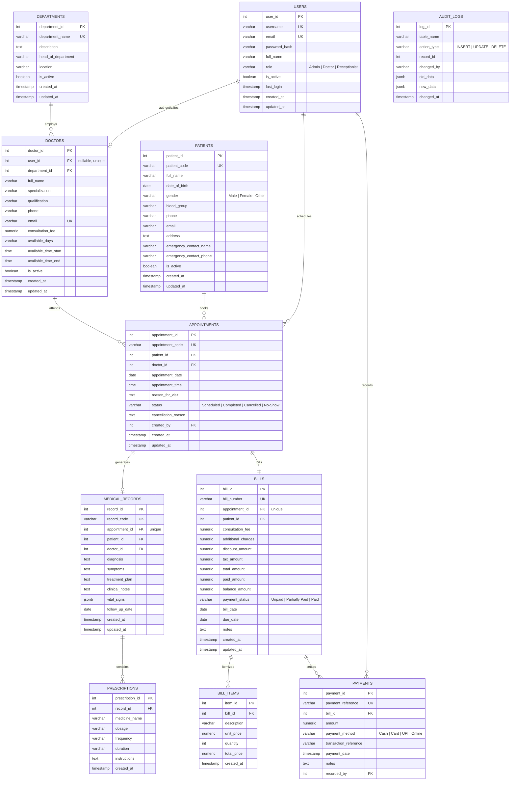

# Hospital Management System — Entity Relationship (ER) Diagram & Relational Schema

## 1. Overview
This document specifies the conceptual, logical, and relational database design for the Hospital Management System DBMS academic project. The schema is designed in **Third Normal Form (3NF)** to ensure zero data redundancy, high transactional integrity, and referential validity.

---

## 2. Mermaid Entity Relationship Diagram (ERD)

---

## 3. Relational Schema Notation

1. **DEPARTMENTS** (<u>department_id</u>, department_name, description, head_of_department, location, is_active, created_at, updated_at)
2. **USERS** (<u>user_id</u>, username, email, password_hash, full_name, role, is_active, last_login, created_at, updated_at)
3. **DOCTORS** (<u>doctor_id</u>, *user_id* &rarr; USERS, *department_id* &rarr; DEPARTMENTS, full_name, specialization, qualification, phone, email, consultation_fee, available_days, available_time_start, available_time_end, is_active, created_at, updated_at)
4. **PATIENTS** (<u>patient_id</u>, patient_code, full_name, date_of_birth, gender, blood_group, phone, email, address, emergency_contact_name, emergency_contact_phone, is_active, created_at, updated_at)
5. **APPOINTMENTS** (<u>appointment_id</u>, appointment_code, *patient_id* &rarr; PATIENTS, *doctor_id* &rarr; DOCTORS, appointment_date, appointment_time, reason_for_visit, status, cancellation_reason, *created_by* &rarr; USERS, created_at, updated_at)
   - *Composite Constraint*: UNIQUE(doctor_id, appointment_date, appointment_time)
6. **MEDICAL_RECORDS** (<u>record_id</u>, record_code, *appointment_id* &rarr; APPOINTMENTS, *patient_id* &rarr; PATIENTS, *doctor_id* &rarr; DOCTORS, diagnosis, symptoms, treatment_plan, clinical_notes, vital_signs, follow_up_date, created_at, updated_at)
7. **PRESCRIPTIONS** (<u>prescription_id</u>, *record_id* &rarr; MEDICAL_RECORDS, medicine_name, dosage, frequency, duration, instructions, created_at)
8. **BILLS** (<u>bill_id</u>, bill_number, *appointment_id* &rarr; APPOINTMENTS, *patient_id* &rarr; PATIENTS, consultation_fee, additional_charges, discount_amount, tax_amount, total_amount, paid_amount, balance_amount, payment_status, bill_date, due_date, notes, created_at, updated_at)
   - *Check Constraint*: `balance_amount = total_amount - paid_amount`
9. **BILL_ITEMS** (<u>item_id</u>, *bill_id* &rarr; BILLS, description, unit_price, quantity, total_price, created_at)
10. **PAYMENTS** (<u>payment_id</u>, payment_reference, *bill_id* &rarr; BILLS, amount, payment_method, transaction_reference, payment_date, notes, *recorded_by* &rarr; USERS)
11. **AUDIT_LOGS** (<u>log_id</u>, table_name, action_type, record_id, changed_by, old_data, new_data, changed_at)

---

## 4. Cardinality Specifications & Foreign Key Rules

| Relationship | Cardinality | Parent Table | Child Table | Foreign Key Column | On Delete Action | On Update Action |
| :--- | :--- | :--- | :--- | :--- | :--- | :--- |
| Department employs Doctors | 1 to Many | DEPARTMENTS | DOCTORS | department_id | RESTRICT | CASCADE |
| User authenticates Doctor | 1 to 0..1 | USERS | DOCTORS | user_id | SET NULL | CASCADE |
| Patient has Appointments | 1 to Many | PATIENTS | APPOINTMENTS | patient_id | RESTRICT | CASCADE |
| Doctor conducts Appointments | 1 to Many | DOCTORS | APPOINTMENTS | doctor_id | RESTRICT | CASCADE |
| Staff schedules Appointment | 1 to Many | USERS | APPOINTMENTS | created_by | SET NULL | CASCADE |
| Appointment yields Medical Record | 1 to 0..1 | APPOINTMENTS | MEDICAL_RECORDS | appointment_id | RESTRICT | CASCADE |
| Medical Record prescribes Items | 1 to Many | MEDICAL_RECORDS | PRESCRIPTIONS | record_id | CASCADE | CASCADE |
| Appointment generates Bill | 1 to 1 | APPOINTMENTS | BILLS | appointment_id | RESTRICT | CASCADE |
| Bill itemizes Services | 1 to Many | BILLS | BILL_ITEMS | bill_id | CASCADE | CASCADE |
| Bill receives Payments | 1 to Many | BILLS | PAYMENTS | bill_id | RESTRICT | CASCADE |
| Cashier records Payment | 1 to Many | USERS | PAYMENTS | recorded_by | SET NULL | CASCADE |
